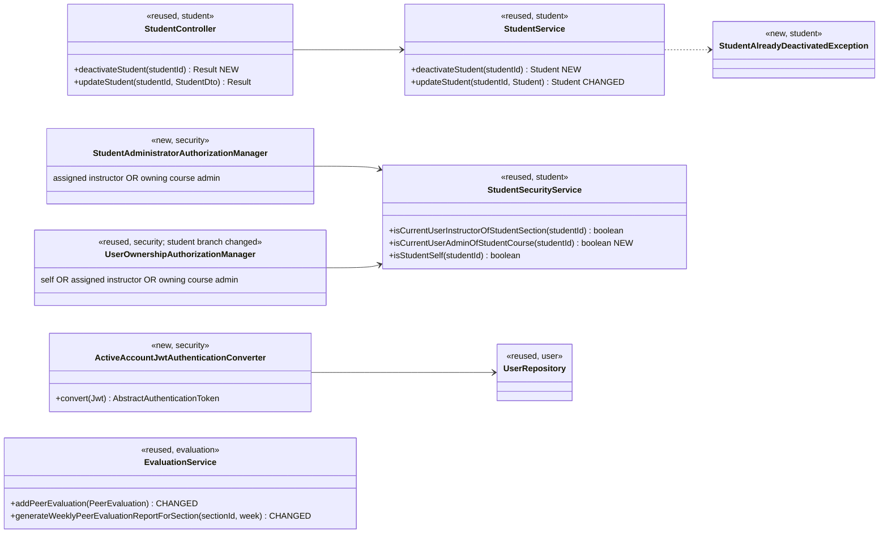
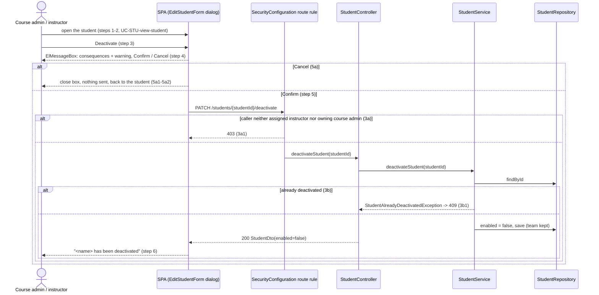
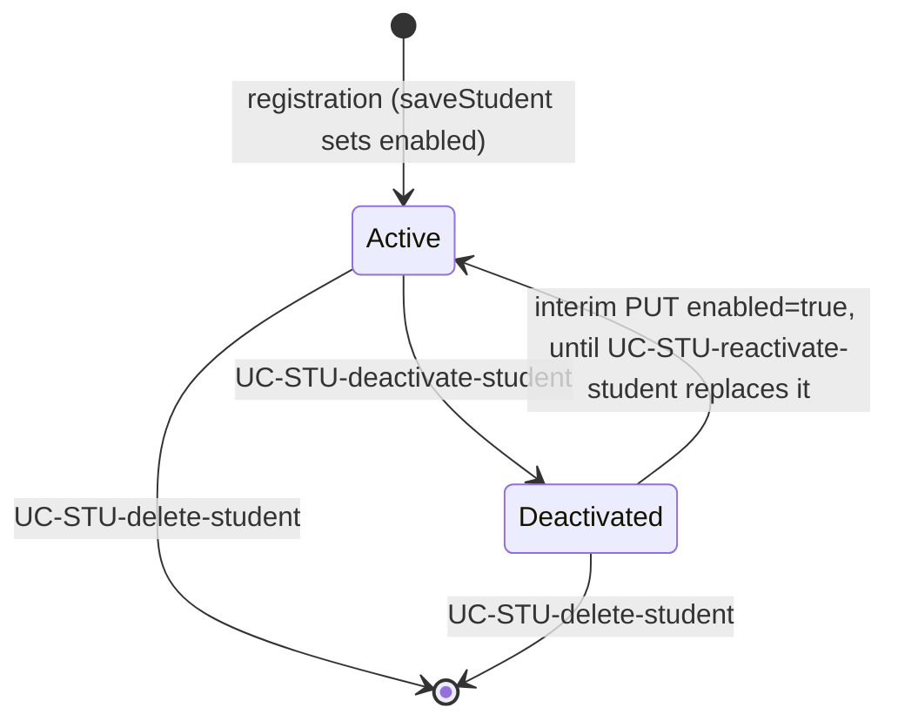

# Students (STU) Design

> Realizes: UC-STU-deactivate-student
> Depends on: FR-SEC-active-account, FR-SEC-authorization, FR-SEC-deny-unauthorized; BR-student-lifecycle, BR-submission-owed, BR-inactive-evaluatee, BR-section-scoped-access
> See: [use cases](../requirements/use-cases.md#student), [SRS security requirements](../requirements/software-requirements-specification.md#security-and-authorization-requirements), [architectural-design.md](architectural-design.md#authentication) (Authentication, Authorization, foundation component view)
> Designed against `main` at `59f0267` (2026-10-27).

## Overview

This area manages a student's account inside a course section. The `student` slice already holds the student's CRUD in the REST API container. Before this design, deactivation was only the `enabled` switch on the generic student edit (`PUT /students/{studentId}`). That path admitted any `ROLE_instructor` the route let through, shut out the course admin, and gave no confirmation or extension handling. The account kept working until its JWT expired, up to 2 hours. Peer evaluations of the student, and the weekly report, ignored her status.

The design adds a dedicated deactivate endpoint and a per-request account check on every API call. It enforces BR-inactive-evaluatee where peer evaluations are created, offered and reported. Her team and records are not touched.

## Components & classes



- **Backend, new:**
  - `StudentController.deactivateStudent` and `StudentService.deactivateStudent` in [`student/`](../../backend/src/main/java/team/projectpulse/student/).
  - `StudentAlreadyDeactivatedException`, mapped to `409` in `ExceptionHandlerAdvice`.
  - `StudentSecurityService.isCurrentUserAdminOfStudentCourse`, following `SectionSecurityService.isSectionOwner` (the student's `section.course.courseAdmin`). It returns `false`, never throws.
  - `StudentAdministratorAuthorizationManager` in `security/authorizationmanagers/`.
  - `ActiveAccountJwtAuthenticationConverter` in `security/`. It wraps the existing `jwtAuthenticationConverter` (`SecurityConfiguration`).
- **Backend, changed:**
  - `StudentService.updateStudent` applies `enabled` only when the caller holds `ROLE_instructor` (the existing check, kept) **and** the value is `true`. `enabled: false` is ignored. See *Deactivation has one path*.
  - `EvaluationService.addPeerEvaluation` refuses a deactivated evaluatee.
  - `EvaluationService.generateWeeklyPeerEvaluationReportForSection` keeps a deactivated student only for a week with peer evaluations of her recorded.
  - `UserOwnershipAuthorizationManager`'s student branch also admits the owning course admin.
- **Frontend:**
  - [`apis/student`](../../frontend/src/apis/student/index.ts) adds `deactivateStudent(studentId)`.
  - [`EditStudentForm.vue`](../../frontend/src/pages/students/EditStudentForm.vue) replaces the `enabled` switch with:
    - a read-only status tag;
    - a **Deactivate** button while the student is active, which opens an `ElMessageBox.confirm` listing the use case's consequences;
    - an interim **Reactivate** button while she is deactivated, which sends the `PUT` with `enabled: true`.
  - [`SubmitTeamsEvaluations.vue`](../../frontend/src/pages/evaluations/SubmitTeamsEvaluations.vue):
    - **New submission:** the rows it builds leave out teammates with `enabled === false`.
    - **Saved evaluations exist for the week:** they load as today, so an evaluation of her written before deactivation is shown for editing.
- **Reused unchanged:**
  - `PeerEvaluationUser.enabled` and the login-time check in `MyUserPrincipal.isEnabled`.
  - `SubmissionStatusService`'s enabled filter (BR-submission-owed).
  - The `401` redirect in `frontend/src/utils/request.ts`.

## Sequence

### UC-STU-deactivate-student: deactivate a student



### FR-SEC-active-account: a deactivated student's live token

```mermaid
sequenceDiagram
    actor St as Deactivated student (still holds a JWT)
    participant F as BearerTokenAuthenticationFilter
    participant AC as ActiveAccountJwtAuthenticationConverter
    participant U as UserRepository
    St->>F: any API request
    F->>AC: convert(jwt)
    AC->>U: findById(userId claim) -> enabled?
    alt disabled or missing
        AC-->>F: DisabledException -> 401
        F-->>St: SPA clears the token and goes to login; login refused (MyUserPrincipal.isEnabled)
    else enabled
        AC-->>F: JwtAuthenticationToken with authorities, as today
    end
```

### Account state



## API contract

| Endpoint or job | Caller (who may) | Request | Success | Errors, by extension |
|---|---|---|---|---|
| `PATCH /api/v1/students/{studentId}/deactivate` (new) | An instructor assigned to the student's course section, or the course admin who owns its course (BR-student-lifecycle): `StudentAdministratorAuthorizationManager`; route rule added before the `denyAll()` catch-all | none | `200`, `StudentDto` with `enabled: false`, team unchanged | 3a: `403` (also for a student, herself included, and for an unknown id: the route refuses first). 3b: `409`, "The student is already deactivated."; the record is unchanged |
| Every authenticated API route (changed) | A JWT holder | — | as today | Account deactivated after the token was issued, or no longer present: `401` |
| `PUT /api/v1/students/{studentId}` (changed) | `UserOwnershipAuthorizationManager`: the student herself, an assigned instructor, or the owning course admin | `enabled: true` reactivates when the caller holds `ROLE_instructor` (interim); `enabled: false` is ignored | as today | — |
| `POST /api/v1/evaluations` (changed) | as today | as today | as today | Evaluatee deactivated: `400`, "<first name> is deactivated and can no longer be evaluated." |
| `GET /api/v1/evaluations/sections/{sectionId}/week/{week}` (changed) | as today | as today | A deactivated student is listed only for a week with peer evaluations of her recorded (BR-inactive-evaluatee) | as today |

`PUT /api/v1/evaluations/{evaluationId}` is unchanged. It still updates an evaluation of a deactivated student written before deactivation, inside the window, because BR-inactive-evaluatee blocks only *new* evaluations.

## Key decisions

**Each request checks that the account is still active.** `ActiveAccountJwtAuthenticationConverter` loads the user by the token's `userId` claim. When the account is disabled or gone it throws `DisabledException`, which the bearer entry point answers with `401`, and the SPA's existing `401` handling returns the student to login. This meets the use case's "takes effect immediately" (FR-SEC-active-account) for instructors as well. Cost: one primary-key lookup per request, negligible at about 80 users.
- Rejected: a token blocklist written at deactivation, which needs a new table and a sweep.
- Rejected: a shorter JWT expiry, which still isn't immediate.

This changes the architecture-of-record's [Authentication](architectural-design.md#authentication) known gaps.

**Deactivation has one path.** It goes through a dedicated `PATCH …/deactivate` endpoint, and the generic `PUT` ignores `enabled: false`.
- Rejected: keeping deactivation inside `PUT`. Extension 3b couldn't be told apart, and the route rule would be the self-or-instructor one.

The `PUT` still accepts `enabled: true`, behind the existing `ROLE_instructor` check in `updateStudent`, as an **interim** reactivation path. The form's Reactivate button uses it.
- Rejected: dropping reactivation until UC-STU-reactivate-student is built. That would strand a student deactivated by mistake, a capability the app has today.
- Rejected: building `/reactivate` now. Its behavior, including its email, belongs to UC-STU-reactivate-student.

The student herself can pass the `PUT` route, but she can't reactivate herself: the `ROLE_instructor` check ignores her `enabled`, and as a deactivated account she gets `401` before the route runs. **UC-STU-reactivate-student's design removes this interim path** (the `enabled: true` handling in `updateStudent` and the Reactivate button) in favor of its own endpoint.

**Who may deactivate.** An assigned instructor OR the owning course admin, composed in `StudentAdministratorAuthorizationManager`, like the NOT area's `anyOf`. Both checks fail closed.
- Rejected: `ROLE_instructor` alone, which admits any instructor in the deployment.
- Rejected: `StudentInstructorAuthorizationManager` alone, which shuts out the course admin that BR-student-lifecycle admits.

For the same reason, `UserOwnershipAuthorizationManager`'s student branch now admits the owning course admin, so step 2 (view the student) works for her. That manager also guards `PUT` and `DELETE /students/{studentId}` and three evaluation `GET`s (by `evaluatorId` or `studentId`). Each of those now admits the owning course admin too, which BR-section-scoped-access already grants her (`DELETE` keeps its own service-level rules).

**Already deactivated is `409`, not an idempotent `200`.** Extension 3b requires an alert.

**The team is kept, and nothing cascades.** `deactivateStudent` changes only `enabled`. BR-inactive-evaluatee and BR-submission-owed are enforced where those records are created or computed: the evaluation `POST`, the form, the section report and `SubmissionStatusService`.
- Rejected: removing her from her team, which would lose her team history and break reactivation.

**The report lists her only for weeks with evaluations of her.** The section report keeps a deactivated student only for a week with peer evaluations of her recorded (BR-inactive-evaluatee).
- Rejected: always omitting her, which hides evaluations her teammates already submitted.
- Rejected: always listing her, which shows an empty row for every later week.

**The form offers no new evaluation of her but keeps an existing one.** On a new submission her row is left out, and the `POST` refuses her anyway. When the evaluator already saved evaluations for the week, the form shows the saved set, so an evaluation of her written before deactivation can still be edited through `PUT`.
- Rejected: hiding her everywhere, which would make the allowed edit reachable only through the API.

**No email.** Neither deactivation nor the interim reactivation sends one. The use case names no notification, and UC-STU-reactivate-student owns the reactivation notice.

## Data model

No delta. `PeerEvaluationUser.enabled` already exists as the SRS's [Business Domain Model](../requirements/software-requirements-specification.md#business-domain-model) defines it, so there is no migration.

## Reuse & cross-cutting

- **Authentication:** the existing login-time disabled check and the SPA's `401` redirect. The new converter only adds the per-request check.
- **Authorization:** both enforcement points from [Authorization](architectural-design.md#authorization).
  - **Route rule:** `StudentAdministratorAuthorizationManager`.
  - **Scoped query:** the service loads by the `studentId` the route rule checked.
- **Submission status:** `SubmissionStatusService` already applies BR-submission-owed's active-account clause. This design doesn't touch it.

## Tests

| Use case, flow | Level | Asserts |
|---|---|---|
| UC-STU-deactivate-student main, assigned instructor | integration | `PATCH` returns `200`; the student is `enabled=false`; `teamId` unchanged; her WARs and evaluations still present |
| Main, owning course admin not assigned to the course section | integration | `200` |
| 3a | integration | An unassigned instructor, a course admin of another course, and a student (herself included) get `403`; the student is unchanged |
| 3b | integration | A second `PATCH` returns `409`; the student is unchanged |
| Step 4 and 5a | E2E (Cypress, API stubbed) | The confirmation box lists the consequences from the use case's Associated Information (no login or submissions, account and work kept, can be reactivated, distinct from deletion, stays on her team, teammates no longer evaluate her, takes effect immediately); Cancel closes it and sends no `PATCH` |
| Step 6 | E2E (Cypress, API stubbed) | Confirm shows "<name> has been deactivated"; the status tag shows deactivated; Deactivate is hidden and Reactivate is shown |
| FR-SEC-active-account | integration | A token issued before deactivation gets `401` on its next request; login is then refused |
| Generic `PUT`, deactivation ignored | integration | `enabled:false` in the body leaves the student enabled |
| Generic `PUT`, interim reactivation | integration | After `PATCH …/deactivate`, a `PUT` with `enabled:true` from the assigned instructor returns `200` and she is enabled, her team unchanged |
| BR-inactive-evaluatee, new evaluation | integration + unit | `POST /evaluations` naming a deactivated teammate returns `400`; a new-submission form omits her |
| BR-inactive-evaluatee, existing evaluation | integration | `PUT /evaluations/{evaluationId}` of an evaluation of her written before deactivation, window open: `200`, scores updated |
| BR-inactive-evaluatee, form shows an existing evaluation | E2E (Cypress, API stubbed) | With saved evaluations for the week that include her, the form lists her row and saving it sends a `PUT`, not a `POST`; with no saved evaluations she is not listed |
| BR-inactive-evaluatee, report | integration | In the section report the deactivated student appears for a week with evaluations of her and is absent for a week with none; an active student with no evaluations still appears |
| BR-submission-owed | (existing) | `SubmissionStatusServiceIntegrationTest` already covers a deactivated student |

## Open questions / risks

- **The interim reactivation path is temporary.** UC-STU-reactivate-student's design must remove `updateStudent`'s `enabled: true` handling and the Reactivate button, and add its own endpoint and email.
- **Wider admission on routes that share `UserOwnershipAuthorizationManager`.** The owning course admin now passes five other student-named routes as well (see *Who may deactivate*). This is consistent with BR-section-scoped-access, but it changes routes this use case doesn't name.
- **A leaked token for an active account** is still valid for its 2 hours ([TD-jwt-revocation](architectural-design.md#risks-and-technical-debt)). The per-request check covers deactivation only.
- **OI-33 (b)** describes deactivation as the `updateStudent` toggle. That wording goes stale once this is built, and `/implement` updates it.
